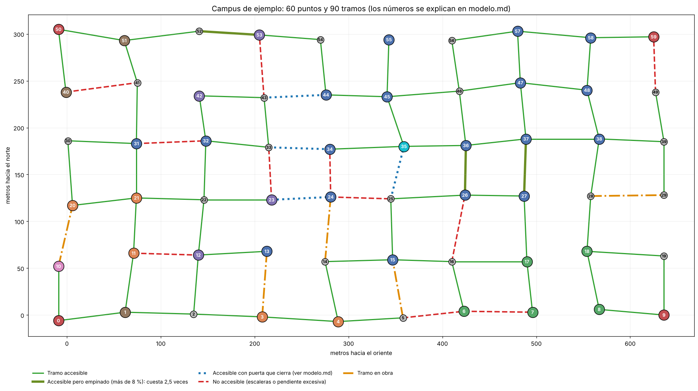

# Modelo del campus accesible

**Autor:** Anwar Joseph

> **Importante:** el campus de este proyecto es un **campus de ejemplo**: lo armé con medidas
> inventadas pero coherentes (60 puntos, 90 tramos, un terreno en ladera). No es el plano de una
> universidad real. Todo el mapa vive en el archivo `campus.py`; para usar un campus real basta con
> reemplazar los datos de ese archivo (ver el final de este documento).

## 1. Qué problema se resuelve

Bienestar Universitario necesita calcular, para una persona con movilidad reducida, la ruta
**más fácil** entre dos puntos del campus. Una ruta es buena si:

- solo usa tramos por los que realmente se puede pasar (sin escaleras, sin obras, sin puertas cerradas);
- cuesta poco esfuerzo: una rampa larga y suave puede ser mejor que un atajo empinado;
- se calcula rápido aunque el campus crezca, sin gastar memoria de más.

## 2. Qué es un nodo

**Un nodo es un punto del campus donde alguien puede llegar, salir o cambiar de camino**: una portería,
un edificio, una plazoleta, un parqueadero, un ascensor, un servicio (cafetería, enfermería...) o un
cruce de caminos. Hay 60.

Cada nodo guarda:

| Dato | Para qué sirve |
| --- | --- |
| Nombre y tipo | Mostrar la ruta con palabras (por ejemplo, «Biblioteca», tipo edificio). |
| Posición x, y (metros) | Dibujar el mapa y calcular la distancia en línea recta, que usa A*. |
| Altura (metros) | Calcular la pendiente de los tramos. |

Internamente cada nodo se identifica con un número del 0 al 59 (su posición en la lista), y los nombres
solo se usan para mostrar resultados.

## 3. Qué es una arista (un tramo)

**Una arista es un tramo: el camino directo entre dos puntos, sin pasar por otro punto en el medio.** Hay 90.
Son **no dirigidas**: si se puede ir de A a B, se puede ir de B a A por el mismo camino, así que cada tramo se
guarda una sola vez como objeto y se anota en los dos extremos.

Cada tramo lleva esta información:

| Atributo | Qué significa | Ejemplo |
| --- | --- | --- |
| Distancia (m) | Metros que realmente se caminan (siempre igual o mayor que la línea recta entre los extremos). | 76 m |
| Pendiente (%) | Qué tan empinado es: 5 % = sube 5 m por cada 100 m. | 1,3 % |
| Accesible | Sí/no: si una persona con movilidad reducida puede pasar. | No (escaleras sin rampa) |
| Motivo | Por qué no es accesible, o «puerta» si tiene horario. | «tramo en obra» |
| Cierra | Hora a la que se cierra la puerta del tramo (o ninguna si siempre está abierto). | 18:00 |
| Costo | Se calcula a partir de la distancia y la pendiente (ver sección 4). | 106,5 |

## 4. El costo de un tramo

Si usáramos solo los metros, la herramienta elegiría el atajo más corto aunque fuera muy empinado. Por eso el costo
mide **esfuerzo**, no solo distancia:

> **costo = distancia × factor de pendiente**

| Pendiente del tramo | Factor | Lectura |
| --- | ---: | --- |
| Hasta 5 % | 1,0 | Cómodo: cada metro cuenta como un metro. |
| Más de 5 % y hasta 8 % | 1,5 | Exige esfuerzo: cada metro cuenta como metro y medio. |
| Más de 8 % y hasta 12 % | 2,5 | Muy cansado: cada metro cuenta como dos metros y medio. |
| Más de 12 % | — | Se marca como **no accesible** (pendiente excesiva). |

Los umbrales (5, 8 y 12 %) son una decisión de este modelo, pensada para que se note la diferencia entre una
rampa suave y una empinada. Se cambian en `grafo.py` (función `factor_por_pendiente`) sin tocar el resto.

**Ejemplos con datos del campus:**

- El tramo *Cruce Plaza Norte - Bloque A Ingeniería* mide 71 m con 7,0 % de pendiente: cuesta 71 × 1,5 = **106,5**.
- El tramo *Cruce Norte 2 - Mirador* mide 72 m con 10,4 %: cuesta 72 × 2,5 = **180**, más del doble de lo que mide.
- Entre *Cruce Sur 2* y *Cruce Norte 2*, la ruta más corta en metros mide 715 m, pero pasa por tramos empinados y
  cuesta **858,5**. La ruta de menor costo camina 727 m (12 m más) pero todo el trayecto es suave y cuesta **727**.
  Esa es la idea de la rampa larga contra el atajo con pendiente fuerte. En este campus, en 504 de los 1.770 pares
  de puntos la ruta más corta en metros **no** es la de menor esfuerzo.

Una propiedad importante: el factor nunca es menor que 1, así que **el costo de un tramo nunca es menor que su
distancia**. Esa propiedad es la que hace admisible la heurística de A* (ver `heuristica.md`).

## 5. Cuándo se puede usar un tramo

Un tramo está **disponible** a una hora dada solo si cumple las dos condiciones:

1. **Es accesible.** No lo es si tiene escaleras sin rampa, está en obra o su pendiente pasa del 12 %.
2. **Su puerta está abierta.** Si tiene hora de cierre, está abierto antes de esa hora y **cerrado desde esa hora**
   (a las 18:00 en punto una puerta que cierra a las 18:00 ya está cerrada).

Las horas se guardan como minutos desde la medianoche (17:45 = 1065) para poder compararlas como números.

En el campus de ejemplo: 90 tramos en total; 74 se pueden usar a las 12:00 y 71 a las 18:15 (cierran tres puertas
a las 18:00; la puerta de las 22:00 sigue abierta).

## 6. Supuestos y límites del modelo

- **La pendiente cuenta igual al subir que al bajar.** En la vida real bajar una pendiente fuerte en silla de ruedas
  también es difícil, pero no cuesta lo mismo que subirla. Con una sola cifra por tramo, el grafo se mantiene simple
  (no dirigido). Si se quisiera distinguirlas, cada tramo tendría dos costos, uno por sentido.
- **Los horarios solo son de cierre de puertas** y son iguales todos los días. No se modelan aperturas
  (por ejemplo, una puerta que abre a las 6:00) ni días festivos.
- **Los tramos en obra se tratan como bloqueados siempre.** No se sabe cuándo terminan.
- **No se modelan ascensores averiados, cintas de piso resbalosas, ni tiempos de espera.**
- Las distancias son las del camino real (con curvas), no la línea recta; el programa revisa que ninguna
  distancia sea menor que la línea recta entre sus extremos y avisa si algún dato no tiene sentido.

## 7. Mapa del campus usado

Cómo leerlo: los círculos son los puntos (el número es el de la tabla de la sección 8; los círculos grandes son
edificios, porterías y servicios, y los pequeños grises son cruces). Las líneas verdes son tramos accesibles; las
verdes gruesas, tramos accesibles pero empinados (más de 8 %); las azules punteadas, tramos con puerta que cierra;
las rojas discontinuas, tramos no accesibles; y las naranjas, tramos en obra. El mapa se redibuja con
`python dibujar_mapa.py` (necesita matplotlib; es opcional).

## 8. Los 60 puntos

| N.º | Punto | Tipo | x (m) | y (m) | Altura (m) |
| ---: | --- | --- | ---: | ---: | ---: |
| 0 | Portería Principal | entrada | -9 | -6 | 0.0 |
| 1 | Parqueadero Sur | parqueadero | 62 | 3 | 1.0 |
| 2 | Cruce Sur 1 | cruce | 135 | 1 | 2.0 |
| 3 | Tienda Universitaria | servicio | 208 | -2 | 3.0 |
| 4 | Cafetería Central | servicio | 289 | -7 | 4.0 |
| 5 | Cruce Sur 2 | cruce | 358 | -3 | 5.0 |
| 6 | Coliseo | deporte | 423 | 4 | 6.0 |
| 7 | Vestuarios | deporte | 496 | 3 | 7.0 |
| 8 | Cancha Sintética | deporte | 567 | 6 | 8.0 |
| 9 | Portería Deportiva | entrada | 636 | 0 | 9.0 |
| 10 | Paradero de Bus | transporte | -9 | 52 | 2.0 |
| 11 | Admisiones y Registro | servicio | 71 | 66 | 3.0 |
| 12 | Plazoleta de Acceso | plazoleta | 140 | 64 | 4.0 |
| 13 | Bloque Administrativo | edificio | 213 | 68 | 5.0 |
| 14 | Cruce Central 1 | cruce | 275 | 57 | 6.0 |
| 15 | Auditorio | edificio | 347 | 59 | 7.0 |
| 16 | Cruce Central 2 | cruce | 410 | 57 | 8.0 |
| 17 | Gimnasio | deporte | 490 | 57 | 9.0 |
| 18 | Piscina | deporte | 554 | 68 | 10.0 |
| 19 | Cruce Deportivo | cruce | 636 | 63 | 11.0 |
| 20 | Enfermería | servicio | 6 | 117 | 4.0 |
| 21 | Bienestar Universitario | servicio | 74 | 125 | 5.0 |
| 22 | Cruce Bienestar | cruce | 146 | 123 | 6.0 |
| 23 | Plazoleta Central | plazoleta | 218 | 123 | 7.0 |
| 24 | Biblioteca | edificio | 281 | 126 | 8.0 |
| 25 | Cruce Biblioteca | cruce | 345 | 124 | 9.0 |
| 26 | Bloque B Ciencias | edificio | 424 | 128 | 10.0 |
| 27 | Laboratorio de Química | edificio | 487 | 127 | 11.0 |
| 28 | Cruce Lab 1 | cruce | 558 | 127 | 12.0 |
| 29 | Cruce Lab 2 | cruce | 636 | 128 | 13.0 |
| 30 | Cruce Oeste 1 | cruce | 1 | 186 | 6.0 |
| 31 | Bloque C Humanidades | edificio | 74 | 183 | 7.0 |
| 32 | Sala de Profesores | edificio | 148 | 186 | 8.0 |
| 33 | Cruce Plaza Norte | cruce | 215 | 179 | 10.5 |
| 34 | Bloque A Ingeniería | edificio | 280 | 177 | 15.5 |
| 35 | Ascensor Bloque A | ascensor | 359 | 180 | 11.0 |
| 36 | Laboratorio de Sistemas | edificio | 425 | 181 | 14.5 |
| 37 | Bloque D Arquitectura | edificio | 489 | 188 | 17.0 |
| 38 | Taller de Maderas | edificio | 567 | 188 | 14.0 |
| 39 | Cruce Taller | cruce | 636 | 185 | 15.0 |
| 40 | Parqueadero Oeste | parqueadero | -1 | 238 | 8.0 |
| 41 | Cruce Oeste 2 | cruce | 75 | 248 | 9.0 |
| 42 | Jardín Botánico | plazoleta | 141 | 234 | 10.0 |
| 43 | Cruce Jardín | cruce | 210 | 232 | 11.0 |
| 44 | Rectoría | edificio | 276 | 235 | 15.0 |
| 45 | Sala de Consejo | edificio | 341 | 233 | 13.0 |
| 46 | Cruce Norte 1 | cruce | 418 | 239 | 14.0 |
| 47 | Centro de Idiomas | edificio | 483 | 248 | 15.0 |
| 48 | Bloque E Posgrados | edificio | 554 | 240 | 16.0 |
| 49 | Cruce Posgrados | cruce | 627 | 238 | 17.0 |
| 50 | Portería Norte | entrada | -9 | 305 | 10.0 |
| 51 | Parqueadero Norte | parqueadero | 61 | 293 | 11.0 |
| 52 | Cruce Norte 2 | cruce | 141 | 303 | 12.0 |
| 53 | Mirador | plazoleta | 205 | 299 | 19.5 |
| 54 | Cruce Mirador | cruce | 270 | 294 | 14.0 |
| 55 | Capilla | edificio | 343 | 294 | 15.0 |
| 56 | Cruce Norte 3 | cruce | 410 | 293 | 16.0 |
| 57 | Centro de Investigación | edificio | 480 | 303 | 17.0 |
| 58 | Sala de Estudio 24h | edificio | 558 | 296 | 18.0 |
| 59 | Portería Oriente | entrada | 625 | 297 | 19.0 |

## 9. Tramos con alguna restricción (20 de 90)

Los otros 70 tramos son accesibles y siempre están abiertos.

| Tramo | Distancia | Pendiente | Qué pasa |
| --- | ---: | ---: | --- |
| 3 Tienda Universitaria - 13 Bloque Administrativo | 81 m | 2.5 % | tramo en obra |
| 5 Cruce Sur 2 - 6 Coliseo | 75 m | 1.3 % | escaleras sin rampa |
| 5 Cruce Sur 2 - 15 Auditorio | 68 m | 2.9 % | tramo en obra |
| 6 Coliseo - 7 Vestuarios | 76 m | 1.3 % | escaleras sin rampa |
| 10 Paradero de Bus - 20 Enfermería | 77 m | 2.6 % | tramo en obra |
| 11 Admisiones y Registro - 12 Plazoleta de Acceso | 77 m | 1.3 % | escaleras sin rampa |
| 14 Cruce Central 1 - 24 Biblioteca | 82 m | 2.4 % | tramo en obra |
| 16 Cruce Central 2 - 26 Bloque B Ciencias | 85 m | 2.4 % | escaleras sin rampa |
| 23 Plazoleta Central - 24 Biblioteca | 76 m | 1.3 % | accesible, pero la puerta cierra a las 18:00 |
| 23 Plazoleta Central - 33 Cruce Plaza Norte | 67 m | 5.2 % | escaleras sin rampa |
| 24 Biblioteca - 25 Cruce Biblioteca | 70 m | 1.4 % | escaleras sin rampa |
| 24 Biblioteca - 34 Bloque A Ingeniería | 55 m | 13.6 % | escaleras sin rampa |
| 25 Cruce Biblioteca - 35 Ascensor Bloque A | 64 m | 3.1 % | accesible, pero la puerta cierra a las 18:00 |
| 28 Cruce Lab 1 - 29 Cruce Lab 2 | 82 m | 1.2 % | tramo en obra |
| 31 Bloque C Humanidades - 32 Sala de Profesores | 85 m | 1.2 % | escaleras sin rampa |
| 33 Cruce Plaza Norte - 34 Bloque A Ingeniería | 71 m | 7.0 % | accesible, pero la puerta cierra a las 18:00 |
| 40 Parqueadero Oeste - 41 Cruce Oeste 2 | 91 m | 1.1 % | escaleras sin rampa |
| 43 Cruce Jardín - 44 Rectoría | 74 m | 5.4 % | accesible, pero la puerta cierra a las 22:00 |
| 43 Cruce Jardín - 53 Mirador | 70 m | 12.1 % | pendiente excesiva |
| 49 Cruce Posgrados - 59 Portería Oriente | 61 m | 3.3 % | escaleras sin rampa |

**Dos casos pensados para la Parte D:**

- La *Biblioteca* (24) solo se puede alcanzar de forma accesible por la puerta de la *Plazoleta Central* (23), que
  cierra a las 18:00: el otro acceso tiene escaleras, el tercero está en obra y el cuarto tiene escaleras con
  pendiente de 13,6 %. Pasadas las 18:00 **no hay ruta accesible** hasta la Biblioteca.
- El *Bloque A Ingeniería* (34) se puede alcanzar por la puerta del *Cruce Plaza Norte* (33), que cierra a las
  18:00, pero también por un rodeo más largo (por la *Rectoría* y el *Ascensor Bloque A*). Pasadas las 18:00 **sí hay
  ruta**, pero más larga.

## 10. Cómo usar un campus real

Todo el mapa está en `campus.py`, en dos listas con formato explicado al comienzo del archivo:

- `NODOS`: nombre, tipo, x, y y altura de cada punto;
- `TRAMOS`: origen, destino, distancia, pendiente, si es accesible, motivo y hora de cierre.

Para pasar a un campus real se reemplazan esas dos listas con las medidas reales (se pueden tomar de un plano o
de una visita al campus) y el resto del proyecto funciona igual. Si una distancia queda menor que la línea
recta entre sus extremos, el programa lo avisa al cargar los datos.
